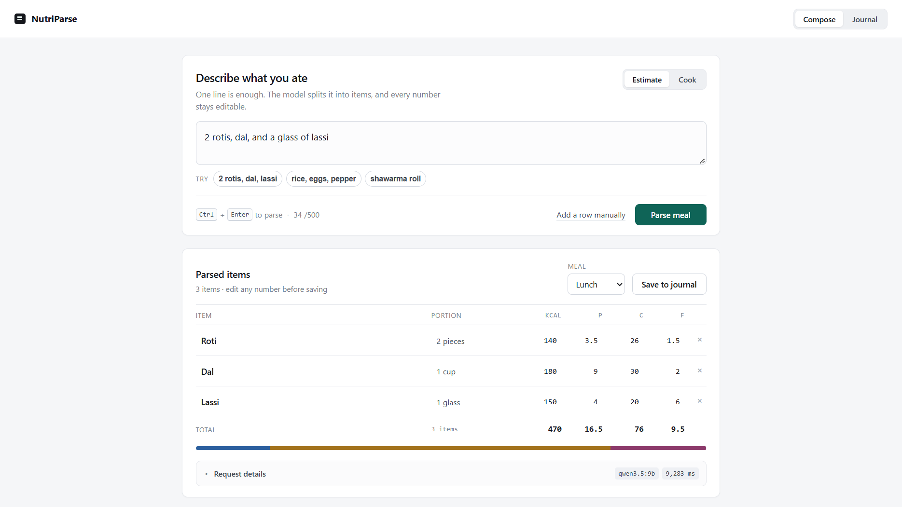
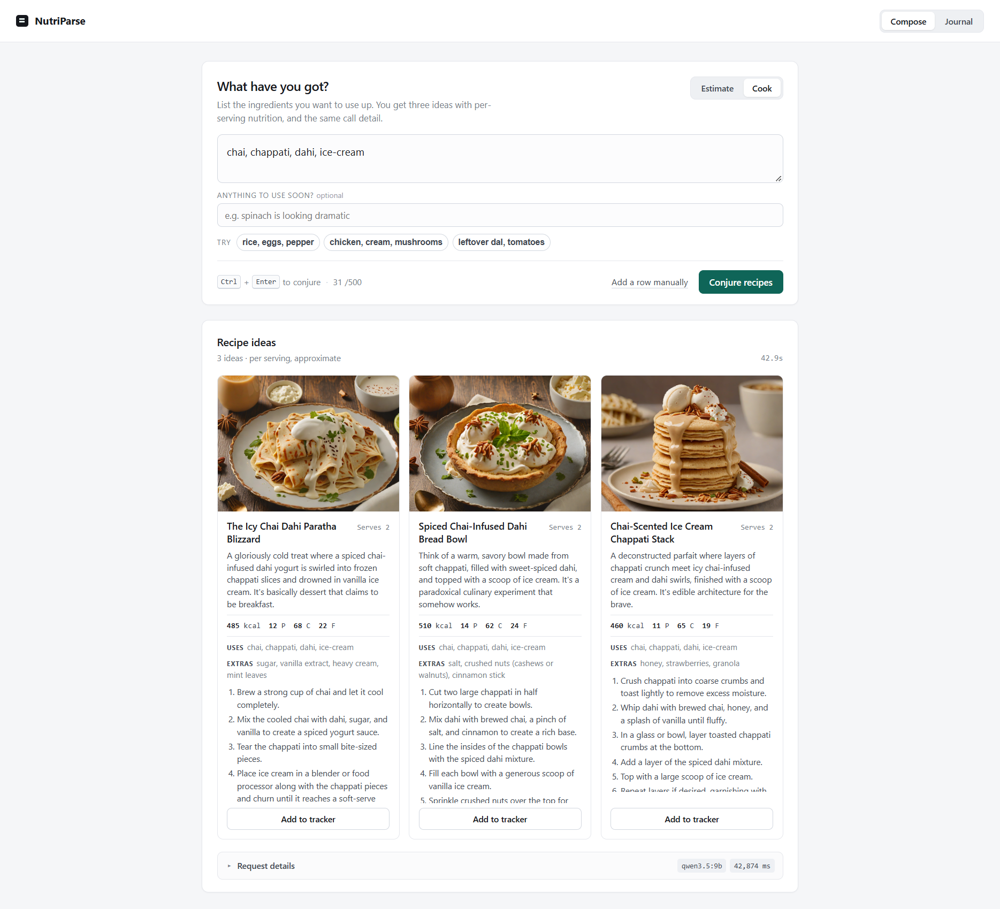
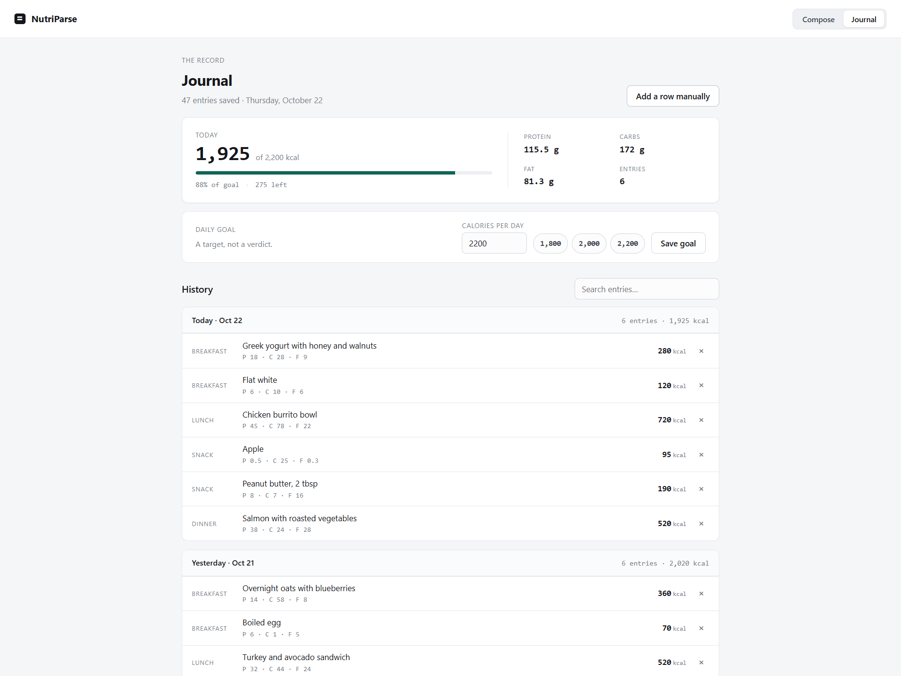
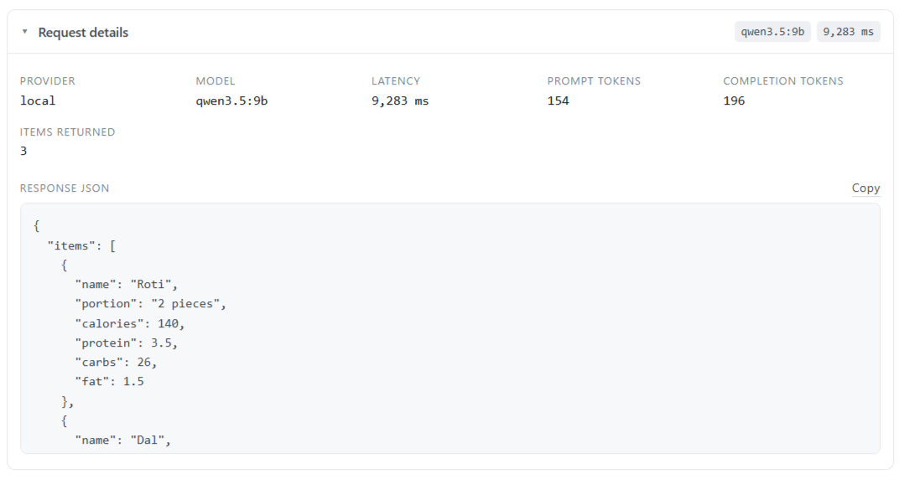

# NutriParse

**LLM Nutrition & Recipe Service**

Turn free text about food into structured, validated nutrition data. A prompt-first web app and a command-line tool, with optional AI estimation and recipe generation from OpenRouter or any local OpenAI-compatible model.

<p align="center">
  
</p>

<p align="center"><sub><b>Compose ? Estimate.</b> One line in, one editable row per food out, totals recomputed from the rows you can see.</sub></p>

Jump to: [Features](#features) — [Tech stack](#tech-stack) — [Web interface](#web-interface) — [Local models](#local-models-no-cloud-calls) — [Tests](#tests) — [Model evaluation](#model-evaluation) — [File layout](#file-layout)

## Features

- **Compose** — describe a meal in one line and get one editable row per food, with server-recomputed totals and the full call detail behind the result (`/api/parse`)
- **Cook** — list ingredients and get three recipe ideas with per-serving macros and optional local images (`/api/leftover-alchemist`); any idea can be seeded into the estimate table for review
- **Journal** — today's calories against your goal, history grouped by day with per-day totals, search, per-entry delete, and an editable daily goal
- **Manual entry** — add a row by hand when you already know the numbers, or when the model is unreachable
- Every parsed name and number stays editable, and totals are recomputed from the rows you can see
- Failures surface as typed messages with a retry; `?sample=1` previews a resolved result without a model call
- Seven-day daily summary with progress toward the goal in the CLI
- One journal store: the web app, the CLI, and the retained legacy journal all read and write the same `data.json` through `store.py`
- A committed evaluation harness scores `/api/parse` against reference calorie ranges, so claims about the model's accuracy carry a table and a date

## Tech stack

| Layer | What NutriParse uses |
| --- | --- |
| Language | Python 3.10+ for the API, CLI, store, and evaluation harness; vanilla JavaScript in the browser |
| Backend | FastAPI on Uvicorn, with Starlette and Pydantic underneath |
| Frontend | HTML5, CSS, and plain JavaScript — no framework, bundler, or build step |
| API surface | REST/JSON endpoints for parsing, cooking, suggestions, recipe images, and journal CRUD |
| LLM providers | OpenRouter by default; any OpenAI-compatible endpoint for local inference — Ollama (default), llama.cpp, LM Studio, vLLM |
| Image generation | stable-diffusion.cpp CUDA build serving SDXL-Turbo through an AUTOMATIC1111-compatible `/sdapi/v1/txt2img` API |
| Persistence | One local JSON document (`data.json`) with validation, atomic `os.replace` writes, and a process-level lock — no database |
| Configuration | `.env` read by the backend, with process environment variables taking priority |
| Testing | Python `unittest` for the store and FastAPI routes; `httpx` provides the `TestClient` transport |
| Evaluation | A committed harness in `evals/` with fixed meal fixtures, reference calorie ranges, and Markdown/JSON results |
| Logging | Python `logging` with a 2 MB rotating handler at `logs/llm.log`, keeping five backups |
| Tooling | pip with `requirements.txt` / `requirements-dev.txt`; Windows batch scripts for the optional CUDA image service |

## Requirements

- Python 3.10+
- FastAPI and Uvicorn

Install the backend dependencies once:

```powershell
python -m pip install -r requirements.txt
```

The journal store and CLI need nothing beyond the standard library. Recipe images are optional and use a separate local service (see below).

## Usage

### Command-line interface

```powershell
python nutriparse.py
```

Follow the on-screen menu to track your intake. The CLI and the web app share one journal (`data.json`, in this folder), so an entry saved in the browser shows up here and the other way round. Entries are read fresh on every command rather than held in memory, which is what makes that true. Option 6 (Suggest nutrition with AI) calls the backend server at `http://localhost:8100`, so start `server.py` first if you want to use it.

### Web interface

1. Start the backend server:

```powershell
python server.py
```

2. Open http://localhost:8100 in your browser. The same app also serves interactive API documentation at http://localhost:8100/docs.

The app has two views, switched from the top bar.

**Compose** is the prompt-first surface, with two intents sharing one input. **Estimate** turns a meal ("2 rotis, dal, and a glass of lassi") into one row per item; **Cook** turns an ingredient list into three recipe ideas with steps and per-serving macros. Every parsed name and number is editable, totals are summed server-side from the rows you can see, and **Request details** exposes the provider, model, latency, token counts, and the raw response JSON in both modes. Failures surface as typed messages with a retry, and images degrade to a labelled strip when the local service is off. **Add a row manually** seeds one blank editable row for numbers you already know; for that row the inspector reads *Pending save* and previews the payload the save will write, instead of implying a model call that never happened.

<p align="center">
  
</p>

<p align="center"><sub><b>Compose ? Cook.</b> The other intent on the same surface: three ideas with per-serving macros and steps, plus the same call detail.</sub></p>

**Journal** is the read side of the same store: today's calories against your goal, protein/carbs/fat totals and entry count, an editable goal with presets, history grouped by day with per-day totals, a search box, and a per-entry delete.

<p align="center">
  
</p>

<p align="center"><sub><b>Journal.</b> Today against the goal, macros to the gram, and history grouped by day — reading the same store the CLI writes to.</sub></p>

Add `?sample=1` or `?sample=cook` to preview either resolved Compose state without a model call, and `?view=journal` to open the Journal view directly.

### Demo data for screenshots

`seed_demo.py` writes a week of sample entries to `data.demo.json`, dated relative to today, so the Journal view has a populated today card and several days of history — including one day over the goal and one light day. Your real `data.json` is never read or written. The Journal screenshot above came from this demo file.

```powershell
python seed_demo.py
python server.py --demo
```

Open http://localhost:8100/?view=journal. `server.py --demo` only changes which file the journal API serves; AI, Cook and images behave as usual. Re-run `seed_demo.py` whenever you want the sample dates to move up to the current day, and delete `data.demo.json` when you are done. Start `server.py` without `--demo` to go back to your real journal.

### Where the journal lives

The server owns `data.json`; the browser keeps no copy of its own. Saving in Compose posts to the server, every mutation answers with the whole updated document, and both views render from that answer. `store.py` holds the rules both front ends share — validation, id assignment, atomic writes — and the CLI calls it directly because it runs on the same machine as the file.

| Endpoint | Body | Returns |
| --- | --- | --- |
| `GET /api/journal` | — | the whole document |
| `POST /api/journal/entries` | `{"entries": [ — ]}` | the document including the new rows, each with a server-assigned id |
| `DELETE /api/journal/entries/<id>` | — | the document without that row |
| `POST /api/journal/goal` | `{"calorie_goal": 2200}` | the document with the new goal |

Writes are validated before they touch the file and then swapped in atomically, so a crash mid-write cannot leave a half-written journal behind. A `data.json` that cannot be parsed is reported — HTTP 500 from the API, exit 1 from the CLI — rather than quietly replaced with a fresh one. Journal writes also check the request's `Origin` and refuse cross-site ones with 403; reads stay open because they change nothing.

Entries saved by an earlier version of the web app, in `localStorage` under `ct_data`, are moved up once on the first page load: valid rows are posted to the server and removed from the browser, and any row the server would reject is left in the browser rather than dropped. The Food Journal is available at http://localhost:8100/food-journal.html and reads and writes the same store. Two caveats worth stating: the migration assumes one tab is open, so two tabs loading at the same instant can each claim the same browser rows and you may see duplicates once; and the write lock is held per process, so a CLI save racing a browser save is last-write-wins rather than a transaction.

`/api/suggest` (single-food estimation, once behind the journal's "Suggest with AI" button) is still served and is still used by CLI option 6. The Compose surface uses `/api/parse` instead.

### Local recipe images (NVIDIA CUDA)

Recipe images use an AUTOMATIC1111-compatible `/sdapi/v1/txt2img` endpoint. On an NVIDIA GPU, run `setup_image_generator.bat` once. It downloads the stable-diffusion.cpp CUDA build (about 900 MB including the CUDA runtime) and Stability AI's SDXL-Turbo checkpoint (6.9 GB). Then launch `start_image_generator.bat` before using Cook mode. The service binds to `127.0.0.1:7860`, uses the GPU, and produces 512—512 images in 6 steps, typically in a few seconds each on an 8 GB laptop GPU. First startup loads the checkpoint and can take 20—40 seconds.

Turbo checkpoints expect CFG 1 and few sampling steps; the start script passes both. It also enables `--offload-to-cpu` so model weights can move through system RAM instead of reserving nearly all GPU memory; this reduces peak VRAM use at the cost of some speed. Image size and steps are read from `.env` (`LOCAL_IMAGE_WIDTH`, `LOCAL_IMAGE_HEIGHT`, `LOCAL_IMAGE_STEPS`). If you replace SDXL-Turbo with a regular checkpoint such as SD 1.5, set `LOCAL_IMAGE_STEPS=20` in `.env` and adjust `--cfg-scale` in the start script. Binaries and model files live in `.image-tools/` and `models/`, both excluded by `.gitignore`.

The image service is optional: if it is stopped, recipe ideas still load without images. Set `LOCAL_IMAGE_GENERATION_ENABLED=false` in `.env` to disable image requests entirely, or override `LOCAL_IMAGE_API_URL` to use another address.

## AI suggestions setup

AI nutrition suggestions require an OpenRouter API key. The key is read by the backend from `.env` — never exposed to the browser or end user.

1. Copy `.env.example` to `.env`:

```powershell
cp .env.example .env
```

2. Fill in `OPENROUTER_API_KEY` with your OpenRouter key. Optionally set `OPENROUTER_MODEL` (defaults to `openrouter/free`). To run without cloud calls, see "Local models" below. Recipe images do not use this key; they are generated locally by the image service.

3. Start `server.py` and compose a meal in the browser, or use CLI option 6.

### Local models (no cloud calls)

Set `LLM_PROVIDER=local` and point `LLM_BASE_URL` at any server that speaks the OpenAI `/chat/completions` API. Nothing in the backend is tied to one runtime: llama.cpp, Ollama, LM Studio, vLLM, and hosted gateways all receive the same request, and the app reads `choices[0].message.content`.

```env
LLM_PROVIDER=local
LLM_BASE_URL=http://localhost:11434/v1
LLM_MODEL=qwen3.5:4b
```

The URL above is Ollama's default; the alternatives are listed below. `LLM_MODEL` is the tag you pulled for Ollama; with llama.cpp keep it equal to `--alias`. Local servers usually need no key; set `LLM_API_KEY` only for a gateway that enforces one.

#### llama.cpp (alternative local setup)

`start_llm.bat` wraps the server command and serves `http://localhost:8080/v1`.

**1. Install llama.cpp.** The simplest route is the `llama` CLI installer, which also gives you `llama serve`:

```powershell
irm https://llama.app/install.ps1 | iex
```

Or download a Windows build from the [llama.cpp releases](https://github.com/ggml-org/llama.cpp/releases). On an NVIDIA GPU take `llama-<build>-bin-win-cuda-x64.zip` **and** the matching `cudart-<build>-bin-win-cuda-x64.zip`; on CPU-only machines take `llama-<build>-bin-win-cpu-x64.zip`. Extract so `llama-server.exe` lands at `.llm-tools\llama-server.exe` (or add it to `PATH`); `.llm-tools/` is gitignored. `start_llm.bat` uses the `llama` CLI when it is on `PATH` and falls back to `llama-server.exe`.

**2. Fetch a GGUF model.** Any instruct model that follows the prompt and emits JSON works. A `Q4_K_M` quant is the usual starting point — roughly 5—6 GB for a 9B model, and small enough for an 8 GB laptop GPU. Put the file under `models\<model-name>\` (or a shared `D:\models\<model-name>\`); GGUF embeds the tokenizer and chat template, so the one file is all the app needs.

```powershell
New-Item -ItemType Directory -Force models\qwen3.5-9b | Out-Null
curl.exe -L -o models\qwen3.5-9b\qwen3.5-9b-Q4_K_M.gguf `
  "https://huggingface.co/<org>/<repo>/resolve/main/<file>.gguf?download=true"
```

Replace the `<—>` placeholders with the repository and filename you chose. `start_llm.bat` looks for `models\qwen3.5-9b\*.gguf`, then `D:\models\qwen3.5-9b\*.gguf`, then any model in `models\`; it skips `mmproj` projectors. Set `LLM_MODEL_FILE` to a full path to use a file somewhere else.

**3. Start the server.** Run `.\start_llm.bat`, or the same command by hand:

```powershell
llama serve -m models\qwen3.5-9b\qwen3.5-9b-Q4_K_M.gguf `
  --alias qwen3.5-9b -c 8192 -ngl 99 --host 127.0.0.1 --port 8080 `
  --jinja --reasoning off
```

If you installed from a release zip instead of the CLI, run `.llm-tools\llama-server.exe` with the same flags. `--alias` is the name the UI reports for the model. `-ngl 99` offloads every layer to the GPU; drop it on a CPU-only build, or lower the number when VRAM is tight. `--reasoning off` matters with thinking models: without it Qwen3.5 spends thousands of tokens before answering, which turned a 7-second parse into a 100-second one in testing. Leave the server running in its own terminal.

**4. Point `.env` at it.**

```env
LLM_PROVIDER=local
LLM_BASE_URL=http://localhost:8080/v1
LLM_MODEL=qwen3.5-9b
LLM_REASONING_EFFORT=
```

`LLM_REASONING_EFFORT` is empty on purpose here: llama.cpp does not read it, so there is no reason to send it.

**5. Verify.** Check that the server answers, then start the app:

```powershell
curl http://localhost:8080/v1/models
python server.py
```

Open http://localhost:8100/, compose a meal, and check the request-details panel. A healthy call shows provider `local`, your alias, a latency in seconds, token counts, and the parsed items. `/api/parse` is also what the legacy journal's Log a meal tab and the CLI's estimate option use, so all three exercise the same path.

#### Ollama

```powershell
ollama pull qwen3.5:9b
ollama serve
```

```env
LLM_PROVIDER=local
LLM_BASE_URL=http://localhost:11434/v1
LLM_MODEL=qwen3.5:9b
```

Ollama serves the same OpenAI-compatible path on port 11434 and keeps the model loaded between calls. Model names keep their `name:tag` form. If an older build rejects `response_format`, set `LLM_JSON_MODE=false`.

#### LM Studio, vLLM, and other servers

| Server | Base URL |
| --- | --- |
| Ollama | `http://localhost:11434/v1` |
| LM Studio | `http://localhost:1234/v1` |
| llama.cpp | `http://localhost:8080/v1` |
| vLLM | `http://localhost:8000/v1` |

Load the model in the server, then set `LLM_BASE_URL`. Set `LLM_MODEL` to the ID the server reports at `/v1/models` when it routes by name (vLLM, LM Studio); with a single-model llama.cpp server the value is only a label. Hosted or self-hosted gateways work the same way — use their `https://—/v1` URL and `LLM_API_KEY` if they require one.

#### Tuning local inference

| Symptom | Lever |
| --- | --- |
| First call is slow, later ones are fast | Expected — the first request loads the model. Watch warm latency in the inspector. |
| `context overflow` or truncated JSON | Raise the context size (`-c` on llama.cpp; the context setting in LM Studio or Ollama). 4096 covers these prompts; 8192 leaves headroom. |
| Out of VRAM | llama.cpp: lower `-ngl`, lower `-c`, add `--cache-type-k q8_0 --cache-type-v q8_0`, or use a smaller quant. Ollama: a smaller quant or `num_gpu` in a Modelfile. |
| A thinking model returns empty content | Stop reasoning at the server: `--reasoning off` (or `-rea off`) on current builds, `--reasoning-budget 0` if yours only has the budget flag, `--chat-template-kwargs '{"enable_thinking":false}'` for Qwen-style templates, or `LLM_REASONING_EFFORT=none` on servers that honour it. |
| Parsing takes ~100 s and reports thousands of completion tokens | Thinking is still on. Restart the server with `--reasoning off`; the same meal then parses in ~7 s and ~200 tokens. |
| HTTP 400 mentioning `response_format` | Set `LLM_JSON_MODE=false`; the prompt still asks for JSON and fenced output is stripped. |
| HTTP 404 from the model call | `LLM_BASE_URL` is missing `/v1`. |
| HTTP 502 —Could not reach Local model— | The server is not running, or the port in `.env` does not match the one the server bound. |

Local providers do not need an API key. `LLM_TIMEOUT` overrides the request timeout (defaults: 30 for nutrition and 45 for recipes on OpenRouter, 180 for local models — generous because a cold load can take a while). Recipe images are unaffected and still use the local image service. Because `evals/results.json` is a snapshot of one model on one date, re-run `python evals/run_parse_eval.py` after changing the model or quant.

<details>
<summary><b>What a local call looks like in the inspector</b> — click to open</summary>

<p align="center">
  
</p>

Every Estimate and Cook result carries this panel: which provider answered, the model, the latency, both token counts, and the raw JSON. Nothing here is inferred from the UI state — it is the call as it happened.

</details>

Text-model requests are recorded in `logs/llm.log`; image-generation requests
are recorded separately in `logs/image_generation.log`. Entries include a
request ID, model or image dimensions and steps, duration, outcome, and useful
image-service error details. Recipe text, prompts, image data, API credentials,
and raw provider payloads are not logged. Each log rotates at 2 MB, keeping up to
five older files.

## Tests

The journal store has a stdlib suite covering validation, atomic writes, legacy numeric ids, corrupt files, and concurrent writers. The FastAPI surface has a second suite covering the route allowlist, the journal round trip, body validation, and the same-origin check on writes:

```powershell
python -m pip install -r requirements-dev.txt
python -m unittest discover -s tests
```

Both front ends are also exercised with headless-browser runs of the Compose, Journal and Cook surfaces during development; those live outside the repo.

## Model evaluation

`evals/` holds a committed harness that scores `/api/parse` against fixed meals with reference calorie ranges. It exists because "the model under-counts" is an anecdote until it is measured, and because a prompt change needs something to compare against.

```powershell
python server.py                    # in one terminal
python evals/run_parse_eval.py      # in another
python evals/run_parse_eval.py --check-fixtures   # offline: validate the cases only
```

Thirteen cases, twelve with a calorie reference and one non-food refusal check. Each case carries per-item ranges and a `basis` naming the composition data behind them, and rows that a model splits are summed before comparison, so a correct split is not punished. The runner reports within-range rate, mean signed error (the bias), mean absolute error, item detection, refusals, latency and tokens, and writes `evals/results.md` plus the raw `evals/results.json`. See `evals/README.md` for the method and its limits.

The committed run is a snapshot of the local model (`qwen3.5:9b`, 21 October 2026): 10 of 12 scored meals landed inside their reference range, with a mean signed error of -4.4%. The aggregate hides the useful part, though. The errors are concentrated in energy-dense food — two slices of pepperoni pizza at 300 kcal against 450—700, two samosas and a chai at 240 against 310—530 — and a meal can total in range while an item inside it is wrong: "2 rotis, dal, and a lassi" lands at 470 kcal against 420—650, with the roti row at 140 kcal against 180—260. The same run also returned `one piece` for "two samosas", which is a portion bug rather than a calorie-estimate bug. Those per-item rows are the reason the harness exists.

## File layout

- `nutriparse.py` — command-line application source
- `store.py` — the shared journal store: validation, atomic writes, totals, used by both the CLI and the server
- `server.py` — FastAPI app serving the public assets plus the journal, AI and image endpoints
- `requirements.txt` — backend dependencies (FastAPI, Uvicorn)
- `requirements-dev.txt` — adds the HTTP test transport (`httpx`)
- `nutriparse.html`, `nutriparse.css`, `nutriparse.js` — the app: the Compose and Journal views, served at `/`
- `journal-client.js` — the browser side of the journal API, including the one-time `localStorage` migration
- `food-journal.html`, `food-journal.css` — The Food Journal at `/food-journal.html`
- `seed_demo.py` — writes `data.demo.json`, sample entries for screenshots; `server.py --demo` serves it instead of the real journal
- `tests/` — store and FastAPI tests (`python -m unittest discover -s tests`)
- `evals/` — the parse evaluation harness, its case fixtures, and the committed results
- `screenshots/` — the screenshots used in this README
- `data.json` — the journal, shared by the CLI and the web app (created on first write; ignored by Git)
- `.env` — your OpenRouter API key (create from `.env.example`; do not commit)
- `.env.example` — documented environment variables template
- `README.md` — this file
- `setup_image_generator.bat` / `start_image_generator.bat` — CUDA recipe image service (stable-diffusion.cpp + SDXL-Turbo)
- `.image-tools/`, `models/` — downloaded image runtime and models (ignored by Git)
